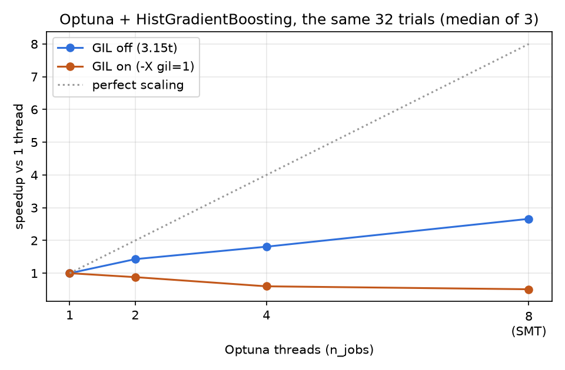

# red-tide

Two questions, one experiment, on Python 3.15t (the free-threaded build):

1. **Can weather and recent counts predict a Florida red tide bloom a week ahead?** The recent
   counts can, clearly better than "it was a bloom last time". The weather adds nothing measurable,
   and nothing calls the *start* of a bloom reliably.
2. **Does Optuna tuning get faster with threads when the GIL is off?** Yes: 2.7× with 8 threads.
   With the GIL on, the same threads make it *slower* than one thread.

## The prediction

A water sample counts as a **bloom** when the alga *Karenia brevis* is at or above
100,000 cells/L. For a sample on day *t* in a 0.25° cell of the southwest Florida shelf (Tampa Bay
to Naples), the model sees only data up to **t − 7 days**:

- 30-day air temperature mean and trend (no sea temperature exists in the free archive before
  2023; coastal air temperature stands in for it);
- 30-day wind speed and the share of days with winds from the NNW;
- 30-day rainfall;
- the season, as the day of the year;
- the latest *K. brevis* count within 20 km, at least 7 days old.

Split by time, never at random: train 2000–2015 (18,720 samples), validate 2016–2017, test
2018 to March 2024 (9,489 samples, 1,305 blooms). Two baselines and three scikit-learn models,
each tuned with 100 Optuna trials on the validation years, then refit on 2000–2017. The "count
only" model sees just the last nearby count, to show what the other features add:

| Model | Test PR-AUC | Recall at 50 % precision | Onset PR-AUC |
|---|---|---|---|
| persistence: "a bloom if the last nearby count was one" | 0.420 | 0.688 | 0.052 |
| season: bloom rate of the month in the training years | 0.232 | 0.000 | 0.088 |
| count only: logistic regression on the last count | 0.554 | 0.737 | 0.163 |
| logistic regression, all features | **0.558** | **0.754** | 0.173 |
| gradient boosting (`HistGradientBoostingClassifier`), all features | 0.556 | 0.752 | **0.178** |

PR-AUC is the main score because blooms are rare; guessing scores the bloom rate (0.138 on the
test years). Accuracy is not reported: "never a bloom" would be 86 % accurate.

What it means:

- **The gain over persistence comes from the count itself.** Persistence only asks "was the last
  count a bloom?"; using *how large* it was lifts PR-AUC from 0.42 to 0.55. Blooms last for weeks,
  and the size of the last count says how far along one is.
- **Weather and season add almost nothing.** All features together score 0.556–0.558 against
  0.554 for the count alone: within noise. Air temperature, wind and rain from a reanalysis grid
  are too coarse a stand-in for what drives a bloom offshore.
- **Boosting finds nothing the linear model misses.** The best parameters are in
  [`results/best_params.json`](results/best_params.json).
- **The start of a bloom stays hard.** On "onset" samples (no bloom nearby a week before; 407
  blooms among 7,850), the models score about 3× the bloom rate, but at 50 % precision they catch
  none. They can rank a risky week higher; they cannot raise a reliable alarm.

Sea temperature, salinity, river discharge and satellite chlorophyll would be the next features
to try; the free NOAA servers for them timed out from the dev machine when checked (2026-10-28).

## The threads

The same 32 Optuna trials of the gradient boosting model in every cell: the parameter sets are
drawn once with a seeded sampler ([`results/bench_params.json`](results/bench_params.json)) and
queued, so the thread count cannot change which trials run, and early stopping is off so each
trial's cost is fixed. Same 3.15t interpreter, GIL off (default) or forced on with `-X gil=1`;
scikit-learn's own OpenMP/BLAS threads are pinned to 1, so only Optuna's threads count. Each run
is a fresh process; GIL modes alternate and the whole grid ran 3 times. The table shows medians
(the three runs agree within about 2 %; all runs are in `results/bench_runs.csv`).



| Threads | GIL off: seconds | speedup | GIL on: seconds | speedup |
|---|---|---|---|---|
| 1 | 53.3 | 1.00 | 56.6 | 1.00 |
| 2 | 37.4 | 1.43 | 64.4 | 0.88 |
| 4 | 29.5 | 1.81 | 94.1 | 0.60 |
| 8 (SMT) | 20.0 | 2.66 | 111.5 | 0.51 |

Machine: AMD Ryzen 5 2500U, 4 cores / 8 threads, a desktop session with a browser open (about
1.7 load from other apps), so absolute times are indicative; the repeats agree closely. The 8-thread point uses SMT, where the
curve keeps rising but well below perfect scaling. With the GIL on, every added thread makes the
study slower: the threads take turns holding the GIL, and the hand-offs cost more than the work
they could share (likely explanation, not profiled).

## Lazy imports (PEP 810)

`cli.py` imports pandas and its own modules with `lazy import`; scikit-learn and Optuna come in
only through those modules, so `bloom --help` loads none of them:

| `bloom --help` | median of 15 runs |
|---|---|
| lazy imports (as shipped) | 0.092 s |
| everything eager | 1.794 s |

This 3.15 build accepts only `-X lazy_imports=all|normal`, with no `none`, so the eager run turns
the lazy imports off with `sys.set_lazy_imports_filter(lambda *a: False)`.

## Run it

```sh
cd red-tide
uv run bloom fetch      # HABSOS + Open-Meteo into data/ (about an hour: the free API is paced)
uv run bloom train      # features, tuning, evaluation on the test years -> results/metrics.csv
uv run bloom bench      # the threading grid (about 25 min) and startup times -> results/
uv run bloom report     # prints the tables above
uv run pytest           # offline; tests never touch the network
```

Weather comes on a 0.5° grid (20 cells): 25 years of daily data per cell counts as hundreds of
calls against Open-Meteo's free limits, so `fetch` waits between requests and when rate-limited.

## Data and licences

- *K. brevis* cell counts: **HABSOS**, NOAA NCEI accession 0120767, version 8.8 (1953 to
  March 2024; 104,932 samples in the region since 2000). Public domain.
- Weather: **Open-Meteo** historical archive (ERA5 reanalysis), CC BY 4.0. Weather data by
  Open-Meteo.com; contains modified Copernicus Climate Change Service information.
